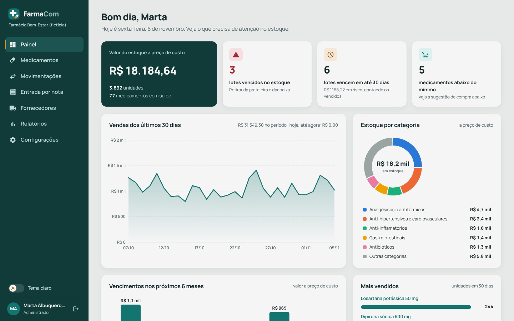
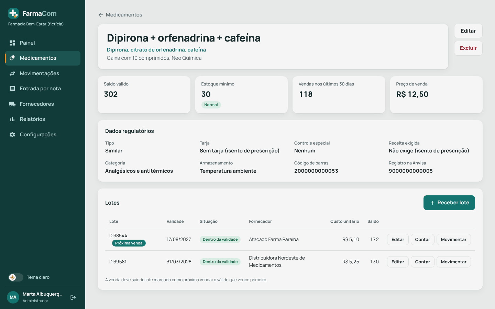

# FarmaCom

Controle de estoque e validade para farmácias de bairro. Mostra o que vence e o que está acabando, obriga a receita na venda de controlados e antimicrobianos e gera os relatórios que a farmácia precisa (perdas, curva ABC, livro de controlados e o arquivo do SNGPC).

Projeto do Desafio Unifacisa, curso de Análise e Desenvolvimento de Sistemas.



## Funcionalidades

**Estoque por lote**
- Cada medicamento tem lotes com validade, custo, fornecedor e saldo próprio
- A venda sai do lote válido que vence primeiro (FEFO); lote vencido não pode ser vendido, só baixado
- Contagem de inventário com ajuste automático e estorno de movimentações
- Entrada pelo XML da NF-e de compra: lê lotes, validades e quantidades e reconhece os itens pelo código de barras ou registro na Anvisa. A mesma nota não entra duas vezes

**Regras de dispensação**
- Tarja, tipo (referência, genérico, similar) e lista da Portaria 344/98 em cada medicamento
- Venda de controlado ou antimicrobiano exige data da receita, prescritor, registro profissional e paciente; listas A, B e C2 exigem também o número da notificação
- Receita de antimicrobiano vale 10 dias a partir da emissão

**Painel e relatórios**
- Vencidos, vencendo, abaixo do mínimo e sugestão de compra (30 dias de vendas + mínimo − saldo válido)
- Gráficos de vendas, estoque por categoria, vencimentos por mês e mais vendidos
- Perdas, movimentação, curva ABC e livro de controlados, em planilha ou PDF
- Arquivo XML para o SNGPC, com conferência de pendências antes de gerar

**Operação**
- Aviso diário por e-mail ou WhatsApp com vencimentos e estoque baixo (opcional)
- Perfis de administrador e atendente
- Tema claro e escuro, com a cor de destaque da farmácia

A pesquisa de mercado e de regulação que orientou essas regras está em [docs/pesquisa.md](docs/pesquisa.md).



## Perfis

| Ação | Atendente | Administrador |
|---|:---:|:---:|
| Registrar vendas, entradas, baixas e notas fiscais | ✓ | ✓ |
| Cadastrar medicamentos e lotes | ✓ | ✓ |
| Alterar tarja, controle especial ou validade de lote | | ✓ |
| Inventário, estorno e exclusões | | ✓ |
| Usuários e configurações | | ✓ |

As restrições valem na API, não só na interface.

## Tecnologias

| Parte | Stack |
|---|---|
| Interface | React 18, Vite, React Router. Gráficos em SVG próprios; jsPDF carregado só ao exportar |
| API | Node.js 22, Express, Zod para validação, SQL direto com `pg` |
| Banco | PostgreSQL 16. O saldo de cada lote é calculado pela view `saldo_lotes` a partir das movimentações, nunca gravado |
| Testes | `node:test` + Supertest contra um Postgres real |
| Publicação | Render (API e interface) e Neon (banco), com CI no GitHub Actions |

```
server/
  db/migracoes/   SQL versionado, aplicado em ordem pelo db/banco.js
  src/routes/     uma rota por recurso (medicamentos, lotes, movimentações, nfe...)
  src/            regras compartilhadas: auth, NF-e, SNGPC, avisos, validação
  test/
web/
  src/pages/      uma tela por rota
  src/components/ formulários, gráficos e componentes de interface
docs/             pesquisa, sprints e capturas de tela
```

## Como rodar

Precisa de Node.js 22 ou superior e de um PostgreSQL. O `docker-compose.yml` sobe o banco de desenvolvimento e o de testes:

```bash
docker compose up -d
```

API (porta 3333):

```bash
cd server
cp .env.example .env
npm install
npm run db:seed
npm run dev
```

Interface (porta 5173), em outro terminal:

```bash
cd web
npm install
npm run dev
```

Abra http://localhost:5173 e entre com uma das contas de demonstração, senha `farmacom123`:

- `demo@farmacom.app` (administrador)
- `atendente@farmacom.app` (atendente)

Os dados são de uma farmácia fictícia. Para testar a entrada por nota, use `web/public/nfe-exemplo.xml`.

### Variáveis de ambiente

Estão comentadas em `server/.env.example`. As principais:

| Variável | Para quê |
|---|---|
| `DATABASE_URL` | Banco da API |
| `JWT_SECRET` | Obrigatória. A API não sobe sem ela |
| `CORS_ORIGIN` | Endereço da interface em produção. Vazio libera qualquer origem |
| `APP_TIMEZONE` | Fuso de "hoje" e "vencido" (padrão `America/Sao_Paulo`) |

## Testes

```bash
cd server
npm test
```

Os testes recriam o banco `farmacom_test` e cobrem as regras de venda, receita, FEFO, permissões, NF-e, SNGPC, curva ABC e migrações. Rodam a cada push no GitHub Actions, junto com o build da interface.

## Avisos diários

Ligados em Configurações. Os canais dependem de variáveis na API:

- E-mail: `SMTP_HOST`, `SMTP_PORT`, `SMTP_USER`, `SMTP_PASS` e `SMTP_FROM`
- WhatsApp: `WHATSAPP_API_URL`, `WHATSAPP_INSTANCIA` e `WHATSAPP_TOKEN` (Evolution API)

A API confere o horário a cada minuto. No plano gratuito do Render ela hiberna, então use um agendador externo (como o cron-job.org) chamando `GET /api/avisos/disparar?chave=AVISOS_CHAVE` uma vez por dia.

## SNGPC

O arquivo gerado em Relatórios segue a estrutura de entradas, saídas e perdas do SNGPC, mas precisa ser validado no ambiente de testes da Anvisa antes de qualquer transmissão real.

## Publicação

A configuração está em `render.yaml`. A cada push na `main`, o Render publica a nova versão e aplica as migrações pendentes. Os dados de demonstração só são criados quando o banco está vazio.

## Equipe

- Guylherme Neves Pinheiro
- Gabriel Gaspar Mendes Bomfim
- João Guilherme Mendes Bomfim
